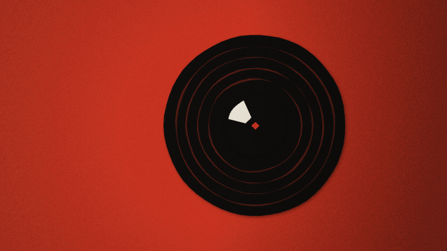

# b-side

A small jazz label that presses one record every night. Each date in Chișinău gets side A: three
tracks by a made-up band, six to eight minutes in all, and a three-act cut-paper film told across
them. Nothing is stored: the date is the seed, and the same night always gives the same record.



<sub>Record no. 1, drawn frame by frame by the site itself (`node scripts/media.mjs`). The GIF has no sound.</sub>

**Listen:** [iliev-blnk.github.io/b-side](https://iliev-blnk.github.io/b-side/). Tonight's record
plays at the top and the catalogue of every earlier night is below. Each night has a link, like
[`#2026-10-23`](https://iliev-blnk.github.io/b-side/#2026-10-23), and a record page, like
[`/r/2026-10-23/`](https://iliev-blnk.github.io/b-side/r/2026-10-23/). The label is also a podcast:
[`feed.xml`](https://iliev-blnk.github.io/b-side/feed.xml).

## How a night becomes a record

- **The pressing.** The date seeds a small PRNG (cyrb128 into sfc32), forked into separate streams
  so changing one decision never shifts another. It picks a mood (noir, chase or sad), the three
  titles, a palette and a sleeve, and casts the band: a leader, a rhythm section, sometimes a second
  horn, strings or a colour instrument, each with a name and a chair.
- **The music.** The mood picks a style for each track: boom-bap jazz-hop, swing, ballad, waltz,
  bossa or shuffle. Track 1 is the title track, track 2 changes the pace, and track 3 is the night's
  big one. Every track has real song form: an intro, a head (A A B A), a solo chorus, the head out
  and an ending (a tag, a fermata, a fade, a button or a run-out). The heads are built from motifs
  and the solos develop them. Walking bass in swing, a two-feel in ballads and a tumbao in bossa sit
  under comping that follows the style, with fills into sections, stop-time hits and drop-outs. It
  all plays through recorded samples (upright bass, piano, brushes and ride, muted trumpet, clarinet,
  flute, strings, marimba and more) and a mix built in Web Audio: room per style, tape, a sidechain
  duck in the hip-hop tracks and vinyl at the run-out.
- **The film.** One figure, one city and one prop (a key, a letter, a ticket for the last train)
  carry through three acts, one per track. Each act is a run of beats from a story grammar for the
  mood: the city, the figure, the encounter, the search or the chase, the quiet, the last look. Every
  beat is a scene on a multiplane camera, with paper layers at depth, pans, push-ins and parallax.
  The puppets are jointed and walk, run, smoke and play. Cuts land on section changes. Lit windows
  follow the chords, the band's hands follow the notes, the camera breathes with the dynamics and the
  type is set on the melody. All of it is re-laid at 12 frames a second, the way stop-motion is shot
  on twos.

With reduced motion turned on, the record plays over its sleeve and nothing moves.

## Sitting in

While a record plays, anyone can play along on the lead instrument. Use the pads, or the keys A to
L. Notes come out in the record's scale on the swing grid, so there are no wrong ones. The figure on
screen plays what you play. Two knobs work live: *band* thins or fills the arrangement, and
*room* goes from dry to smoky. A take, meaning your notes and knob moves, can be kept in the link
(`#2026-10-23/take=…`) for anyone to hear with the band. There is no server. The timeline under the
film scrubs through the three acts.

## The label

Every night at midnight in Chișinău, the **Press** workflow renders the new record headlessly in
Chromium:

- the side as an MP3;
- the film as a 720p MP4;
- the sleeve as a 3000 px PNG.

All three go on a GitHub Release, `r-<date>`. Nothing is committed. **Pages** then rebuilds the site:

- a static page for every record, with the sleeve as its card, the film as og:video, the
  tracklist, the band and liner notes written from the same seed;
- the podcast feed of the sides;
- `catalogue.json`, which drives the catalogue's sleeve wall, month view, filters (mood, style and
  instrument) and search.

## Old records never change

The generator is versioned. When it changes after launch, the new version takes over from a given
date and the old one stays in `src/record/press.ts`, so every earlier night plays as it was first
pressed. `test/pins.test.ts` holds hashes of the sleeve, the side, the film and the liner notes for
a handful of nights to keep it that way.

## Running it

Node 24 and pnpm.

```sh
pnpm install
pnpm dev          # the site
pnpm test         # dates, pressings, the band, the film, takes, the label, pinned records
pnpm smoke        # plays, sits in, scrubs, browses the catalogue and opens a record page in Chromium
node scripts/press.mjs 2026-10-23                # renders a side offline and checks its levels
node scripts/film.mjs sheet 2026-10-23           # a contact sheet of the film
node scripts/stills.mjs 2026-10-23 --scene=roof  # frames of one scene
node scripts/label.mjs press 2026-10-23          # what the nightly pressing makes, into renders/label/
node scripts/label.mjs site                      # the site with record pages, feed and catalogue
```

The scripts that open a browser expect Chromium at `/usr/bin/chromium` (or set `CHROMIUM`).

## Credits

The samples come from the [Versilian Community Sample Library](https://github.com/sgossner/VCSL)
and [VSCO-2 Community Edition](https://github.com/sgossner/VSCO-2-CE), both CC0; see
[CREDITS.md](CREDITS.md). The type is [Jost](https://github.com/indestructible-type/Jost) (OFL).
Code under the [MIT licence](LICENSE).
